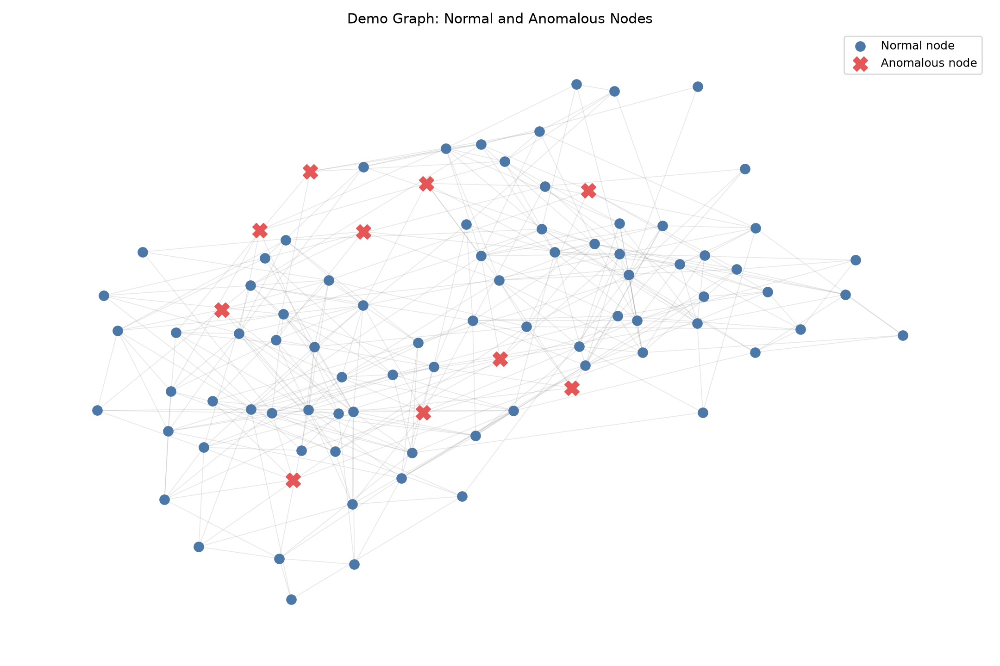

# Graph Anomaly Detection

### A beginner-friendly demonstration of baseline, few-shot, and zero-shot anomaly detection on graphs

[](https://www.python.org/)
[](https://networkx.org/)
[](https://streamlit.io/)
[](#license)

An educational implementation inspired by the research paper **“From Few-Shot to Zero-Shot: Towards Generalist Graph Anomaly Detection.”** The project demonstrates how graph structure and node features can be used to identify suspicious nodes and compare different context-based detection strategies.

> **Scope:** This repository is a simplified academic demonstration. It does not reproduce the paper's complete ARC/ARCzero deep-learning architecture or its large-scale experiments.

## Overview

Graphs are used to represent computer networks, social networks, financial transactions, and many other connected systems. In these graphs, an anomalous node is one whose behaviour differs significantly from the majority.

This project evaluates three approaches:

| Method | Context available | Main idea |
|---|---|---|
| Baseline | Normal profile | Compare each node with the average normal-node profile |
| Few-shot | Five known normal nodes | Use a small labelled context set |
| Zero-shot | No labelled context | Automatically select typical nodes as pseudo-normal context |

## Demo preview



Blue circles represent normal nodes. Red X-shaped nodes represent anomalies in the demonstration dataset.

## Features

- Generates a reproducible synthetic graph dataset.
- Stores nodes, features, labels, and edges as readable CSV files.
- Visualizes graph structure and feature differences.
- Calculates baseline anomaly scores.
- Demonstrates few-shot detection with limited normal examples.
- Demonstrates zero-shot detection without labelled context.
- Evaluates precision, recall, F1-score, and ROC-AUC.
- Provides an interactive Streamlit dashboard.
- Includes presentation notes for an academic demonstration.

## Technology stack

- **Python** - application and experiment code.
- **NumPy** - numerical and feature calculations.
- **Pandas** - tabular data processing and CSV output.
- **NetworkX** - graph creation, analysis, and visualization layout.
- **Matplotlib** - charts and saved figures.
- **Streamlit** - interactive web dashboard.
- **Jupyter** - optional notebook-based experimentation.
- **Scikit-learn and Seaborn** - included for future evaluation and visualization extensions.

## Project structure

```text
dm-assignment/
├── app.py                         # Streamlit dashboard
├── requirements.txt               # Python dependencies
├── LECTURER_NOTES.md              # Presentation and viva preparation
├── data/                          # Generated graph data
├── notebooks/                     # Step-by-step project notes
├── results/                       # Images, metrics, and comparison reports
└── src/                           # Project source code
```

## Quick start

### 1. Clone the repository

```bash
git clone https://github.com/Fhiroj93/dm-assignment.git
cd dm-assignment
```

### 2. Install dependencies

Python 3.11 or newer is recommended.

```bash
python -m pip install -r requirements.txt
```

### 3. Run the experiments

```bash
python src/data_generator.py
python src/explore_data.py
python src/baseline_detector.py
python src/few_shot_detector.py
python src/zero_shot_detector.py
python src/evaluate_models.py
```

### 4. Launch the dashboard

```bash
python -m streamlit run app.py
```

Open the local URL shown in the terminal, usually `http://localhost:8501`.

## How the implementation works

The demo graph contains 90 nodes, 336 edges, 80 normal nodes, 10 anomalous nodes, and four numerical features per node. The anomaly labels are used only for evaluation and visualization; the zero-shot context-selection step does not use them.

Each method assigns every node a numerical score. A higher score means the node is farther from the selected normal or pseudo-normal feature profile and is therefore more suspicious.

### Evaluation metrics

- **Precision:** how many selected nodes were actually anomalous.
- **Recall:** how many real anomalies were found.
- **F1-score:** combined precision and recall.
- **ROC-AUC:** ranking quality across score thresholds.

## Expected result

On the included synthetic dataset, all three methods achieve perfect scores. This is expected because the dataset intentionally gives anomalous nodes clearly separated feature values. These results confirm that the demonstration works, but they should not be interpreted as real-world model performance.

## Suggested demo flow

1. Explain nodes, edges, features, and anomalies.
2. Show `results/exploration/graph_overview.png`.
3. Open the Streamlit dashboard.
4. Demonstrate the Baseline method.
5. Demonstrate Few-shot using five known normal nodes.
6. Demonstrate Zero-shot using automatically selected pseudo-normal nodes.
7. Show the comparison table and chart.
8. Explain the limitations and possible improvements.

## Limitations and future work

The current project uses a small synthetic dataset and transparent feature-distance detectors rather than learned GNNs. It is a simplified educational implementation, not a full reproduction of ARC and ARCzero.

Possible extensions include adding a public graph dataset, implementing GCN/GraphSAGE/GAT with PyTorch Geometric, adding learned feature alignment and cross-attention, and testing on multiple datasets.

## Academic reference

Liu, Y., Li, S., Zheng, Y., Chen, Q., Zhang, C., Yu, P. S., and Pan, S. **From Few-Shot to Zero-Shot: Towards Generalist Graph Anomaly Detection.**

## License

This repository is intended for educational and academic demonstration purposes.
